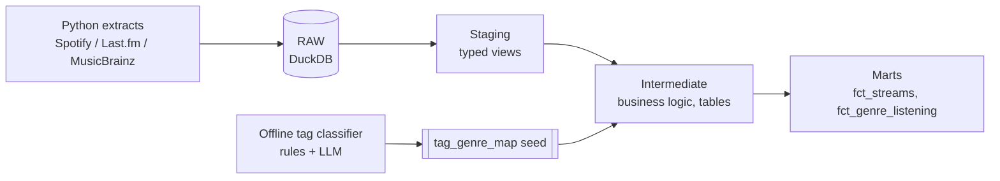

# Spotify Analytics

[](https://github.com/petinhoss7/Spotify-Analytics/actions/workflows/dbt_ci.yml)

A dbt + DuckDB analytics project that turns a Spotify streaming history into
trustworthy listening analytics — the flagship question being **how much time
do I actually spend listening to each genre?**

Genre attribution is not a single label copied from an API. Three independent
tag sources (Spotify genres, Last.fm, MusicBrainz) are reconciled against the
closed Discogs taxonomy, scored with explainable weights, and listening minutes
are then split across an artist's genres **proportionally to the evidence**.

```
Childish Gambino  ->  Hip Hop 73.0% | Funk / Soul 19.9% | Rock 7.1%
Lana Del Rey      ->  Pop 49.0% | Rock 36.9% | Electronic 9.5% | FW&C 4.6%
```

## How it works



| Layer | What it does |
|---|---|
| `scripts/` | Loads the Spotify export, enriches artists/tracks via APIs, classifies raw tags offline |
| `models/staging/` | Flattens JSON, types columns, normalizes timestamps to UTC, hashes IPs (PII) |
| `models/intermediate/` | Deduplication, listening features, artist profiles, cross-source comparison, genre scoring & attribution |
| `models/marts/` | `fct_streams` (one row per music stream) and `fct_genre_listening` (minutes per month x genre) |
| `seeds/` | Closed Discogs taxonomy (15 genres / 611 styles) and the 12,697-tag classification map |
| `tests/` | Singular reconciliation and business-rule tests |

Full DAG and model-by-model documentation: [`docs/architecture.md`](docs/architecture.md).
Interactive version: `dbt docs generate && dbt docs serve`.

### Genre attribution in one paragraph

Every genre-classified tag becomes a weighted row:
`row_weight = method_weight x ln(1 + tag_count)` (exact/alias 1.0, fuzzy 0.9,
LLM 0.8), summed per artist x genre and multiplied by a cross-source bonus
`1 + 0.5 x (distinct_sources - 1)` so agreement outranks tag volume. The top
genre is the primary; a second genre is kept only with two sources and at least
50% of the primary score. `genre_share` (shares sum to 1 per artist) is what
`fct_genre_listening` uses to split listening time across **all** scored genres.
Styles are ranked only within the final genres, so a sub-genre is always
coherent with its parent genre.

## Data sources

| Raw table | Produced by | Content |
|---|---|---|
| `RAW_SPOTIFY_STREAMING` | `scripts/load_raw.py` | One JSON record per play (export files, Parquet) |
| `RAW_SPOTIFY_ARTISTS` | `scripts/spotify_api` (RapidAPI) | Artist metadata + Spotify genres |
| `RAW_SPOTIFY_TRACK_ARTISTS` | `scripts/spotify_api` | Track ↔ artist associations |
| `RAW_SPOTIFY_AUDIO_FEATURES` | `scripts/spotify_api` | Danceability, energy, valence, tempo… |
| `RAW_LASTFM_ARTIST_GENRES` | `scripts/lastfm_api` | Top Last.fm tags per artist |
| `RAW_MUSICBRAINZ_ARTISTS` | `scripts/musicbrainz_api` | Country, dates, community tags |

Credentials live in `.env` (copy `.env.example`). The `raw` schema and the
DuckDB file (`data/spotify.duckdb`) are local only and never committed.

## Quick start

Requires Python 3.12+.

```bash
python -m venv .venv
source .venv/bin/activate          # Windows: .venv\Scripts\activate
pip install -r requirements.txt
dbt deps
```

With production data already loaded into `data/spotify.duckdb`:

```bash
dbt build                          # seeds + models + 169 tests
dbt docs generate && dbt docs serve
```

### Run the pipeline on the CI fixture

You do not need the real export to validate the whole DAG — `ci/seed_fixture.py`
creates a small but complete DuckDB database (5 artists, 8 tracks, streams over
two months, every reconciliation bucket):

```bash
python ci/seed_fixture.py
dbt build --profiles-dir ci --target ci
```

### Refresh the data

```bash
python scripts/load_raw.py                       # Spotify export (Parquet)
python scripts/spotify_api/extract_artist_genres.py
python scripts/lastfm_api/extract_lastfm_artist_genres.py
python scripts/musicbrainz_api/extract_musicbrainz_artist_details.py
python scripts/classifier/classify_tags.py       # rewrites seeds/tag_genre_map.csv
dbt build
```

The classifier layers (normalization → exact → alias → token containment → LLM
→ review) are cached in `data/tag_llm_cache.json`, so re-runs are free and
resumable.

## Data quality

`dbt build` runs 169 tests, including 14 singular tests that guard the logic
rather than the columns:

- `fct_streams` and `fct_genre_listening` reconcile against their upstream
  models (rows and minutes), and genre shares sum to 1 per month;
- every staging tag is mapped (no silently dropped tags) and every
  `(genre, style)` pair belongs to the closed Discogs list;
- attribution reconciles with the line-by-line classification, its scores match
  `int_artists_genre_scores`, the secondary-genre rule holds, and each style is
  coherent with its parent genre.

Failures are stored in the `test_failures` schema (`+store_failures: true`).

## CI

`.github/workflows/dbt_ci.yml` runs on every push and pull request:

1. installs `dbt-duckdb`;
2. `dbt deps`;
3. generates the synthetic fixture (`ci/seed_fixture.py`);
4. runs `dbt build --target ci` (28 models/seeds + 169 tests).

No credentials or private data are needed — the fixture database is generated
in the job and git-ignored.

## Repository layout

```
.
├── ci/                     # CI profile + synthetic fixture generator
├── data/                   # local DuckDB database and LLM cache (git-ignored)
├── docs/architecture.md    # DAG, model roles, attribution rules
├── extracts/               # raw API exports (git-ignored)
├── models/
│   ├── staging/            # typed views, 1:1 with sources
│   ├── intermediate/       # business logic (tables)
│   └── marts/              # serving layer (tables)
├── seeds/                  # Discogs taxonomy, tag map, aliases
├── scripts/                # ingestion + offline tag classifier
├── tests/                  # singular reconciliation / business-rule tests
└── dbt_project.yml
```

## Current state

- History covered: **2018-09-23 → 2026-02-04**, 175,484 raw plays → 173,659
  music streams.
- 17,369 artists, 39,788 tracks, 14,753 artists with a genre attribution
  (1,480 flagged ambiguous).
- 12,697 raw tags classified (389 exact, 47 alias, 1,860 containment, 10,297
  LLM, 104 noise).
- Last full build: **197/197 nodes green** (28 models/seeds, 169 tests).
