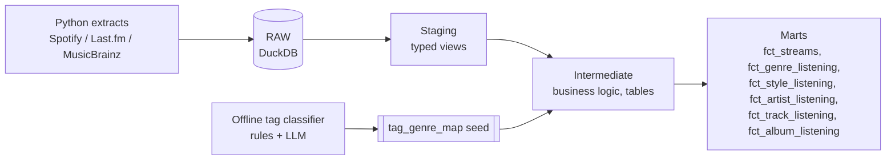

# Spotify Analytics

[](https://github.com/petinhoss7/Spotify-Analytics/actions/workflows/dbt_ci.yml)

A dbt + DuckDB analytics project that turns a Spotify streaming history into
trustworthy listening analytics — the flagship question being **how much time
do I actually spend listening to each genre?**

Genre attribution is not a single label copied from an API. Three independent
tag sources (Spotify genres, Last.fm, MusicBrainz) are reconciled against the
closed Discogs taxonomy, scored with explainable weights, and listening minutes
are then split across an artist's genres **proportionally to the evidence**.

```
Childish Gambino  ->  Hip Hop 73.0% | Funk / Soul 19.9% | Rock 7.1%
Lana Del Rey      ->  Pop 49.0% | Rock 36.9% | Electronic 9.5% | FW&C 4.6%
```

## How it works



| Layer | What it does |
|---|---|
| `scripts/` | Loads the Spotify export, enriches artists/tracks via APIs, classifies raw tags offline |
| `models/staging/` | Flattens JSON, types columns, normalizes timestamps to UTC, hashes IPs (PII) |
| `models/intermediate/` | Deduplication, listening features, artist profiles, cross-source comparison, genre scoring & attribution |
| `models/marts/` | The serving layer: `fct_streams` (one row per music stream), `fct_genre_listening` and `fct_style_listening` (minutes per month × genre / style), and `fct_artist_listening`, `fct_track_listening`, `fct_album_listening` (minutes per month for each artist, track and album) |
| `seeds/` | Closed Discogs taxonomy (15 genres / 611 styles), the 12,697-tag classification map, and the hand-verified verdicts |
| `tests/` | Singular reconciliation and business-rule tests |

Full DAG and model-by-model documentation: [`docs/architecture.md`](docs/architecture.md).
Interactive version: `dbt docs generate && dbt docs serve`.

### Genre attribution in one paragraph

Every genre-classified tag becomes a weighted row:
`row_weight = method_weight x ln(1 + tag_count)` (verified/exact/alias 1.0,
fuzzy 0.9, LLM 0.8), summed per artist x genre and multiplied by a cross-source
bonus `1 + 0.5 x (distinct_sources - 1)` so agreement outranks tag volume.

Each artist is then described by a **combination** of four attributes: a
primary pair `(primary_genre, primary_style)` and a secondary pair
`(secondary_genre, secondary_style)`, each style belonging to the genre it is
paired with. The secondary pair is kept only when it is real evidence: at
least 2 distinct tags must back it, or it must still weigh at least 10% of the
primary score — a genre resting on a single stray tag is not a genre.

A few cases cannot be settled by any threshold: evidence cannot judge
*plausibility*. Marsh gets a `Rock / Black Metal` secondary from two low-count
Last.fm tags whose numbers (10% of the primary, 2 tags) are indistinguishable
from Red Hot Chili Peppers' legitimate `Funk / Soul` secondary (10%, 1 tag).
Those go in `seeds/artist_overrides.csv`, a small hand-made table applied as
the final step of the attribution — see
[`docs/architecture.md`](docs/architecture.md).

### From the artist to listening time

The genre is an attribute of the **artist** (a fact, never divided); listening
time is a **quantity**. Going from one to the other is an allocation, defined
once in `int_stream_artist_pairs`:

1. a stream's minutes are divided by the number of artists on the track;
2. each artist's share goes to their primary pair `(genre, style)` at **0.7**
   and to their secondary pair at **0.3** — an artist without a secondary
   keeps the whole share on the primary pair.

The weights sum to 1 per (stream, artist), which is what keeps the totals
additive instead of double-counting a minute. Because a pair is
`(genre, style)`, **the same rule serves both levels**:

- `fct_genre_listening` — month x genre;
- `fct_style_listening` — month x genre x style, and the styles of a genre
  roll up **exactly** to the genre table (tested).

| message | question | what to use |
|---|---|---|
| « quel est le genre de ce morceau ? » | a label | `fct_streams.lead_primary_genre` — a denomination, no proportion |
| « combien de temps par genre ? » | a **measure** | `fct_genre_listening` |
| « combien de temps par style ? » | a **measure** | `fct_style_listening` |

**Never compare the label with the measures**: summing minutes by
`lead_primary_genre` gives different numbers on purpose, because it cannot
spread the 13% of minutes whose track artists disagree on genre.

## Data sources

| Raw table | Produced by | Content |
|---|---|---|
| `RAW_SPOTIFY_STREAMING` | `scripts/load_raw.py` | One JSON record per play (export files, Parquet) |
| `RAW_SPOTIFY_ARTISTS` | `scripts/spotify_api` (RapidAPI) | Artist metadata + Spotify genres |
| `RAW_SPOTIFY_TRACK_ARTISTS` | `scripts/spotify_api` | Track ↔ artist associations |
| `RAW_SPOTIFY_AUDIO_FEATURES` | `scripts/spotify_api` | Danceability, energy, valence, tempo… |
| `RAW_LASTFM_ARTIST_GENRES` | `scripts/lastfm_api` | Top Last.fm tags per artist |
| `RAW_MUSICBRAINZ_ARTISTS` | `scripts/musicbrainz_api` | Country, dates, community tags |

Credentials live in `.env` (copy `.env.example`). The `raw` schema and the
DuckDB file (`data/spotify.duckdb`) are local only and never committed.

## Quick start

Requires Python 3.12+.

```bash
python -m venv .venv
source .venv/bin/activate          # Windows: .venv\Scripts\activate
pip install -r requirements.txt
dbt deps
```

With production data already loaded into `data/spotify.duckdb`:

```bash
dbt build                          # seeds + models + 169 tests
dbt docs generate && dbt docs serve
```

### Run the pipeline on the CI fixture

You do not need the real export to validate the whole DAG — `ci/seed_fixture.py`
creates a small but complete DuckDB database (5 artists, 8 tracks, streams over
two months, every reconciliation bucket):

```bash
python ci/seed_fixture.py
dbt build --profiles-dir ci --target ci
```

### Refresh the data

```bash
python scripts/load_raw.py                       # Spotify export (Parquet)
python scripts/spotify_api/extract_artist_genres.py
python scripts/lastfm_api/extract_lastfm_artist_genres.py
python scripts/musicbrainz_api/extract_musicbrainz_artist_details.py
python scripts/classifier/classify_tags.py       # rewrites seeds/tag_genre_map.csv
dbt build
```

The classifier layers (normalization → exact → alias → token containment → LLM
→ review) are cached in `data/tag_llm_cache.json`, so re-runs are free and
resumable.

## Data quality

`dbt build` runs 225 tests, including 19 singular tests that guard the logic
rather than the columns:

- `fct_streams` reconciles with its upstream model, and `fct_genre_listening`
  and `fct_style_listening` both reconcile with `fct_streams` (rows and
  minutes), with shares summing to 1 per month;
- the allocation conserves time: the pair weights sum to `1 / artist_count`
  for every stream × artist, and the **styles of a genre roll up exactly** to
  `fct_genre_listening`;
- every staging tag is mapped (no silently dropped tags) and every
  `(genre, style)` pair belongs to the closed Discogs list;
- attribution reconciles with the line-by-line classification, its scores match
  `int_artists_genre_scores`, and each style is coherent with the parent genre
  it is paired with.

Failures are stored in the `test_failures` schema (`+store_failures: true`).

The classifier has its own unit tests, run in CI:

```bash
python -m unittest discover -s scripts/classifier -p "test_*.py"
```

### Hand verification of the head

Most of the evidence sits on a few hundred tags, so those are checked by hand
rather than trusted:

```bash
python scripts/classifier/tags_to_verify.py    # top 200 tags, verdict columns empty
# ...fill verdict / correct_genre / correct_style in seeds/tags_to_verify.csv
python scripts/classifier/apply_verdicts.py    # -> seeds/tag_verified.csv
python scripts/classifier/classify_tags.py     # applies it, then rebuilds the seed
```

`tags_to_verify.py` pre-fills the current classification and keeps verdicts
already present when regenerated; its `variant_family` column groups spellings
of one word (plural kept, so `afrobeat` and `afrobeats` stay apart).
`apply_verdicts.py` validates every verdict against the taxonomy — anything it
cannot express is reported, never guessed, and the few cases left open are
resolved by an explicit `DECISIONS` table in the script.

Current effect: **253 tags verified**, carrying **80,608 genre rows across
13,962 artists**. LLM-decided evidence fell from 61,026 rows to **12,960**: the
head of the distribution is now human-decided, with weight 1.0.

## CI

`.github/workflows/dbt_ci.yml` runs on every push and pull request:

1. installs `dbt-duckdb`;
2. `dbt deps`;
3. runs the classifier unit tests and the gold-set evaluation;
4. generates the synthetic fixture (`ci/seed_fixture.py`);
5. runs `dbt build --target ci` (225 nodes: 22 models, 9 seeds/views and
   194 data tests).

No credentials or private data are needed — the fixture database is generated
in the job and git-ignored.

## Repository layout

```
.
├── ci/                     # CI profile + synthetic fixture generator
├── data/                   # local DuckDB database and LLM cache (git-ignored)
├── docs/architecture.md    # DAG, model roles, attribution rules
├── extracts/               # raw API exports (git-ignored)
├── models/
│   ├── staging/            # typed views, 1:1 with sources
│   ├── intermediate/       # business logic (tables)
│   └── marts/              # serving layer (tables)
├── seeds/                  # Discogs taxonomy, tag map, aliases
├── scripts/                # ingestion + offline tag classifier
├── tests/                  # singular reconciliation / business-rule tests
└── dbt_project.yml
```

## Current state

- History covered: **2018-09-23 → 2026-02-04**, 175,484 raw plays → 173,659
  music streams.
- 17,369 artists, 39,788 tracks, 14,660 artists with a genre attribution
  (2,709 unclassified).
- 12,697 raw tags classified: 253 hand-verified, 388 exact, 31 alias,
  1,783 containment, 10,110 LLM, 132 noise / workflow artifacts.
- Closed taxonomy: 15 genres, **612 styles**, built from merged Discogs
  exports by `scripts/build_taxonomy.py`.
- Listening: **7 570 h** across 6 marts — `fct_genre_listening` (1 287 rows,
  `Electronic 36.2% / Rock 18.5% / Pop 16.8% / Hip Hop 8.9%`),
  `fct_style_listening` (11 942 rows, `(no_style)` carries 10.4%),
  `fct_artist_listening` (64 487), `fct_track_listening` (83 267) and
  `fct_album_listening` (66 043).
- Last full build: **269/269 nodes green** plus 45 classifier unit tests.
