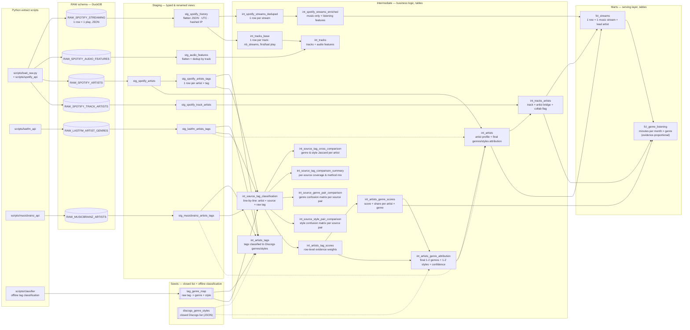

# Spotify Analytics — Architecture

## DAG overview

Solid arrows = model dependencies, dashed = secondary metadata joins.
Interactive version: `dbt docs generate` then `dbt docs serve`.

## Role of each model

### Sources (`raw` schema, loaded by Python scripts)

| Source | Loaded by | Content |
|---|---|---|
| `RAW_SPOTIFY_STREAMING` | `load_raw.py` (Spotify extended history export) | One JSON record per play: track, timestamp, ms played, platform, reasons, IP… |
| `RAW_SPOTIFY_ARTISTS` | `load_raw.py` + `scripts/spotify_api` | Artist metadata via RapidAPI: followers, popularity, genres |
| `RAW_SPOTIFY_TRACK_ARTISTS` | `load_raw.py` + `scripts/spotify_api` | Track ↔ artist associations |
| `RAW_SPOTIFY_AUDIO_FEATURES` | `load_raw.py` + `scripts/spotify_api` | Audio features per track (JSON): danceability, energy, valence… |
| `RAW_LASTFM_ARTIST_GENRES` | `scripts/lastfm_api` | Last.fm top tags per artist |
| `RAW_MUSICBRAINZ_ARTISTS` | `scripts/musicbrainz_api` | MusicBrainz artist metadata: country, dates, tags |

### Staging (views, 1:1 with source — only typing, renaming, flattening)

| Model | Role |
|---|---|
| `stg_spotify_history` | Flattens JSON plays, types columns, normalizes timestamps to UTC, hashes IP (PII) |
| `stg_audio_features` | Flattens audio-features JSON, dedupes to one row per track |
| `stg_spotify_artists` | Typed artist metadata |
| `stg_spotify_artists_tags` | Unnests genre lists → one row per artist × tag |
| `stg_spotify_track_artists` | Typed track ↔ artist pairs |
| `stg_lastfm_artists` / `stg_lastfm_artists_tags` | Parses Last.fm JSON, extracts tags (deduped) |
| `stg_musicbrainz_artists` / `stg_musicbrainz_artists_tags` | Typed MusicBrainz metadata + flattened tags |

### Seeds (closed list + offline classification)

| Seed | Role |
|---|---|
| `discogs_genres_styles` | Closed Discogs list flattened from `discogs_genres_styles.json` (15 genres x 611 styles); referential-integrity reference for tests. Built by `scripts/build_taxonomy.py`, which merges several Discogs exports — see below |
| `tag_genre_map` | 1 row per unique raw tag (12,697): `is_genre_tag`, `discogs_genre`, `discogs_style`, `match_method`, `match_score`. Produced offline by `scripts/classifier/classify_tags.py` |
| `tags_to_verify` | The reviewer's working list: the 200 most-used tags (64.6% of all evidence) pre-filled with the current classification. Regenerable without losing verdicts (`scripts/classifier/tags_to_verify.py`) |
| `tag_verified` | The reviewer's verdicts, applied by the classifier **before every automatic layer** (`scripts/classifier/apply_verdicts.py`). Not materialized in the warehouse |
| `artist_overrides` | Hand-made artist-level corrections, applied as the **final step** of `int_artists_genre_attribution`. Materialized in the warehouse |

#### Hand verification of the head

The seed's `match_method` values rank the evidence by how it was decided, and
the head of the distribution carries most of the weight, so it is checked by
hand:

1. `tags_to_verify.py` writes the 200 most-used tags (64.6% of all artist x tag
   evidence) pre-filled with the current classification and empty verdict
   columns, plus a `variant_family` column that groups spellings of one word
   (plural deliberately kept, so `afrobeat` and `afrobeats` stay apart).
2. The reviewer fills `verdict` (`ok` / `nok`) and, when wrong,
   `correct_genre` / `correct_style` / `comment`.
3. `apply_verdicts.py` validates every verdict against the taxonomy and writes
   `tag_verified.csv`. Anything it cannot express is **reported, never
   guessed**; the few cases the reviewer left open are resolved by an explicit,
   auditable `DECISIONS` table in the script.
4. The layer is applied first, with weight 1.0 (`match_method = 'verified'`), so
   the highest-volume evidence is human-decided.

Current effect: 253 tags verified (spelling variants collapse onto one key),
80,608 genre rows / 13,962 artists carrying verified evidence, and LLM-decided
evidence down from 61,026 rows to 12,960.

#### Building the closed taxonomy

`seeds/discogs_genres_styles.json` is **reference data, not hand-edited**:
`scripts/build_taxonomy.py` merges every available Discogs export and writes
both the JSON (with its provenance and counts in `meta`) and the flat
`discogs_genre_styles.csv` seed.

Sources are merged, never replaced. The Discogs style list evolves and no
single export is complete: a 2022 export and the older local file each missed
styles the other had — the local file lacked `Lo-Fi`, `Lounge` and
`Jangle Pop`, the export lacked `Deep Funk`, `Detroit Techno` and
`Proto-Punk`. A straight replacement would have dropped 13 styles and
invalidated 45 pairs already in use.

Two rules keep the result sound:

- **one spelling per style**, grouped by normalized form, so `Norteno` and
  `Norteño` cannot both exist and fold onto the same lookup key;
- **a style named after a different genre is dropped**: the export lists
  `Hip Hop` and `Latin` as styles under Electronic, which would make the tags
  `hip hop` (1,964 artists) and `latin` (542) ambiguous and send them to the
  LLM instead of resolving them deterministically.

Current build: **15 genres, 611 styles, 592 exact keys, 16 ambiguous keys**,
with 0 spelling collisions and 0 in-use pairs invalidated.

#### Tag classification (offline, `scripts/classifier/`)

Layers, in priority order per tag: hand-checked verdicts
(`seeds/tag_verified.csv`) -> normalization -> exact match against the
closed list -> alias rewrite (`seeds/tag_aliases.csv`) -> token-boundary
containment of a closed-list key (longest key wins, ties abstain) -> LLM
classification (GLM via OpenRouter, closed list in the system prompt,
server-side validation) -> review file for anything left. Pure-noise tags
(numbers, hex, decades) are flagged non-genre deterministically. LLM answers
are cached in `data/tag_llm_cache.json`, so re-runs are free and resumable.
Ambiguous style names shared by several genres ("dub", "disco", "ska"...)
never match deterministically; they are always decided by the LLM layer.

### Intermediate (tables, business logic)| Model | Role |
|---|---|
| `int_spotify_streams_deduped` | One row per stream — removes plays duplicated across export files (keeps latest load) |
| `int_spotify_streams_enriched` | Music-only streams + listening features: `stream_date`, hour, weekday, `is_meaningful_listen` (≥30 s) |
| `int_tracks_base` | One row per track: stream count, first/last played, latest metadata |
| `int_tracks` | Track dimension: base + audio features |
| `int_artists_tags` | Standalone fact table: 1 row per artist × tag classified to a Discogs genre/style (non-genre tags excluded) — the queryable detail behind the attribution |
| `int_source_tag_classification` | Line-by-line comparison base: faithful union of the 3 staging tag views (1 row = artist × source × raw tag, nothing filtered) left-joined to `tag_genre_map`, with `classification_status` = genre / non_genre / empty_tag / unmapped |
| `int_source_tag_cross_comparison` | Cross-source agreement at artist level: pivoted Discogs genre and style sets per source, shared/union sets, Jaccard `agreement_score` (genre) and `subgenre_agreement_score` (style); artists genre-classified in ≥2 sources |
| `int_source_tag_comparison_summary` | Per-source figures: rows, distinct tags/artists, genre & style rates, method mix (exact/alias/fuzzy/llm/noise), populations excluded from scoring |
| `int_source_genre_pair_comparison` | Confusion matrix per source pair at genre level: (genre_a, genre_b) co-occurrence counts + mean pairwise Jaccard |
| `int_source_style_pair_comparison` | Confusion matrix per source pair at style level (style-name-only matching), same structure |
| `int_artists_genre_attribution` | Final attribution: 1 row per artist — primary + secondary genre (rule-gated) and styles, weighted-score based, with `primary_share`, `combined_confidence`, `is_ambiguous` |
| `int_artists` | Consolidated artist profile: Spotify + Last.fm + MusicBrainz data + the final Discogs attribution embedded from `int_artists_genre_attribution` (primary/secondary genre & style, confidence, ambiguity flag) |
| `int_tracks_artists` | Track × artist bridge with artist count and `is_collaboration` flag |
| `int_artists_tag_scores` | Row-level evidence weights: 1 row = artist × source × genre-classified tag, `row_weight = method_weight × ln(1 + tag_count)` — the single definition consumed by attribution and marts |
| `int_artists_genre_scores` | Genre evidence scores: 1 row = artist × genre (ALL scored genres), `genre_score` with cross-source bonus + `genre_share` (0-1, shares sum to 1 per artist). This is the **evidence** distribution; it is no longer the listening rule, which reads `int_stream_artist_pairs` instead |
| `int_stream_artist_pairs` | Listening allocation: 1 row = stream × artist × pair `(genre, style)`. The stream's minutes are divided by the number of artists, then each artist's share goes 0.7 to their primary pair and 0.3 to their secondary one (`pair_weight` sums to 1 per stream × artist). The single definition consumed by `fct_genre_listening` and `fct_style_listening` |

#### Source tag comparison & final attribution

`int_source_tag_classification` is the audit base: every staging tag line
keeps its raw value and its classification outcome, so any source can be
drilled line by line (guards: row-count reconciliation against the staging
views and zero `unmapped` lines). On top of it:

- **Cross-source comparison**: for each artist, the genre (and style) sets
  derived independently from each source are compared with a simple Jaccard
  score (shared / union). Pairwise confusion matrices expose systematic
  disagreements between sources (e.g. Rock vs Pop for the same artists).
- **Final attribution** (`int_artists_genre_attribution`): each artist is
  described by a **combination** of four attributes — a primary pair
  `(primary_genre, primary_style)` and a secondary pair
  `(secondary_genre, secondary_style)`, each style belonging to the genre it
  is paired with. Genres are scored with an explainable weighted sum —
  `row_weight = method_weight × ln(1 + tag_count)` (verified/exact/alias 1.0,
  fuzzy 0.9, llm 0.8), genre score
  multiplied by `(1 + 0.5 × (distinct_sources − 1))` so cross-source
  agreement outranks tag volume. Primary = top score; the secondary genre is
  the runner-up, kept only when it is real evidence — at least
  `attribution_min_secondary_tags` distinct tags back it, or it still weighs
  at least `attribution_min_secondary_score_ratio` of the primary. A genre
  resting on a single stray tag is not a genre (an isolated `pop`,
  `orchestral` or `black metal` used to invent a second genre at ~1% of the
  primary score). Counts, not weights, are used for the tag floor, so sources
  without a tag count are not penalised. Strength is always reported through
  `secondary_score_ratio`, `secondary_nb_tags` and `secondary_sources_count`.
  Styles are ranked **within each genre**, so the primary style is
  the best style of the primary genre, and the secondary style the best style
  of the secondary genre. `combined_confidence = 0.6 × primary_share +
  0.4 × (sources / 3)`; `is_ambiguous` flags near-ties (runner-up ratio
  ≥ 0.75), in which case the two pairs are best read as unordered.

- **Artist-level overrides** (`seeds/artist_overrides.csv`): a small hand-made
  table applied as the final step of the attribution, where each row fixes the
  four label columns for one artist. It exists because **evidence cannot judge
  plausibility**: Marsh comes out with a `Rock / Black Metal` secondary from
  two low-count Last.fm tags, and its numbers (10% of the primary, 2 tags) are
  indistinguishable from Red Hot Chili Peppers' legitimate `Funk / Soul`
  secondary (10%, 1 tag). No threshold on ratio, tag count or listener count
  separates them — the junk sits *between* two valid cases (Marsh 12 listener
  tags, Post Malone 11, RHCP 20). Those cases need an explicit decision.

  An override nulls the evidence-derived scores, share, ratio and confidence
  for that artist rather than leaving them describing a ranking that no longer
  applies, and `attribution_source` says whether a row came from evidence or
  from the seed. Pairs are validated against the closed list by
  `test_artist_overrides_pair_valid`. The **evidence-proportional listening
  split is deliberately not overridden**: `fct_genre_listening` distributes
  minutes by `genre_share` over all scored genres, which answers a different
  question than "which genre is this artist".

#### Score models (shared by attribution and marts)

`int_artists_tag_scores` / `int_artists_genre_scores` define the
scoring math once (row weights, genre scores, `genre_share`). `genre_share`
is the **evidence** distribution: it is no longer what the listening marts
use, since they read the simpler artist-pair allocation, and it stays exposed
as metadata about how strongly a genre is attested. The attribution model
consumes them (guards: `test_attribution_scores_match_genre_scores`,
`test_genre_scores_shares_sum`).

### Marts (serving layer)

| Model | Role |
|---|---|
| `fct_streams` | Event fact: 1 row = 1 music stream, reconciled to `int_spotify_streams_enriched` (rows + minutes); denormalized lead artist (name-matched, deterministic fallback), `artist_count`, `is_collaboration`, `lead_primary_genre` |
| `fct_genre_listening` | Listening minutes per month × genre. Allocation from `int_stream_artist_pairs`: a stream's minutes are divided by the number of artists on the track, then each artist's share goes 0.7 to their primary `(genre, style)` pair and 0.3 to their secondary one. Two explicit buckets (`unclassified` = artist without a genre attribution, `no_artist_data` = track absent from the bridge) keep every month's total equal to `fct_streams`. **This is a measure, not a track label** — see `fct_streams.lead_primary_genre` for the denomination, and never compare the two |
| `fct_style_listening` | The same allocation grouped by **style** instead of genre (month × genre × style), with a `(no_style)` bucket for pairs that carry a genre but no specific style. Because it groups the same model, the styles of a genre roll up **exactly** to `fct_genre_listening` (guarded by `test_fct_style_listening_rolls_up_to_genre`). Style evidence is sparse by nature — 65.7% of (artist, style) couples rest on a single tag — and `(no_style)` carries 10.4% of the minutes, mostly under Pop |

Per-artist distributions on real data: Childish Gambino → Hip Hop
73.0 / Funk / Soul 19.9 / Rock 7.1; Lana Del Rey → Pop 49.0 / Rock
36.9 / Electronic 9.5 / FW&C 4.6.
