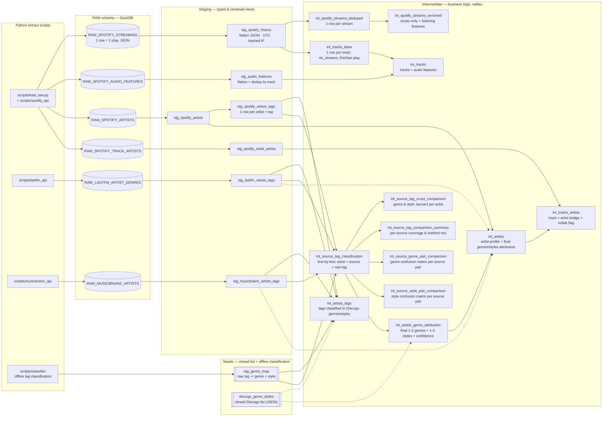

# Spotify Analytics — Architecture

## DAG overview

Solid arrows = model dependencies, dashed = secondary metadata joins.
Interactive version: `dbt docs generate` then `dbt docs serve`.

## Role of each model

### Sources (`raw` schema, loaded by Python scripts)

| Source | Loaded by | Content |
|---|---|---|
| `RAW_SPOTIFY_STREAMING` | `load_raw.py` (Spotify extended history export) | One JSON record per play: track, timestamp, ms played, platform, reasons, IP… |
| `RAW_SPOTIFY_ARTISTS` | `load_raw.py` + `scripts/spotify_api` | Artist metadata via RapidAPI: followers, popularity, genres |
| `RAW_SPOTIFY_TRACK_ARTISTS` | `load_raw.py` + `scripts/spotify_api` | Track ↔ artist associations |
| `RAW_SPOTIFY_AUDIO_FEATURES` | `load_raw.py` + `scripts/spotify_api` | Audio features per track (JSON): danceability, energy, valence… |
| `RAW_LASTFM_ARTIST_GENRES` | `scripts/lastfm_api` | Last.fm top tags per artist |
| `RAW_MUSICBRAINZ_ARTISTS` | `scripts/musicbrainz_api` | MusicBrainz artist metadata: country, dates, tags |

### Staging (views, 1:1 with source — only typing, renaming, flattening)

| Model | Role |
|---|---|
| `stg_spotify_history` | Flattens JSON plays, types columns, normalizes timestamps to UTC, hashes IP (PII) |
| `stg_audio_features` | Flattens audio-features JSON, dedupes to one row per track |
| `stg_spotify_artists` | Typed artist metadata |
| `stg_spotify_artists_tags` | Unnests genre lists → one row per artist × tag |
| `stg_spotify_track_artists` | Typed track ↔ artist pairs |
| `stg_lastfm_artists` / `stg_lastfm_artists_tags` | Parses Last.fm JSON, extracts tags (deduped) |
| `stg_musicbrainz_artists` / `stg_musicbrainz_artists_tags` | Typed MusicBrainz metadata + flattened tags |

### Seeds (closed list + offline classification)

| Seed | Role |
|---|---|
| `discogs_genres_styles` | Closed Discogs list flattened from `discogs_genres_styles.json` (15 genres x 372 styles); referential-integrity reference for tests |
| `tag_genre_map` | 1 row per unique raw tag (12,697): `is_genre_tag`, `discogs_genre`, `discogs_style`, `match_method`, `match_score`. Produced offline by `scripts/classifier/classify_tags.py` |

#### Tag classification (offline, `scripts/classifier/`)

Layers, in priority order per tag: normalization -> exact match against the
closed list -> alias rewrite (`seeds/tag_aliases.csv`) -> token-boundary
containment of a closed-list key (longest key wins, ties abstain) -> LLM
classification (GLM via OpenRouter, closed list in the system prompt,
server-side validation) -> review file for anything left. Pure-noise tags
(numbers, hex, decades) are flagged non-genre deterministically. LLM answers
are cached in `data/tag_llm_cache.json`, so re-runs are free and resumable.
Ambiguous style names shared by several genres ("dub", "disco", "ska"...)
never match deterministically; they are always decided by the LLM layer.

### Intermediate (tables, business logic)

| Model | Role |
|---|---|
| `int_spotify_streams_deduped` | One row per stream — removes plays duplicated across export files (keeps latest load) |
| `int_spotify_streams_enriched` | Music-only streams + listening features: `stream_date`, hour, weekday, `is_meaningful_listen` (≥30 s) |
| `int_tracks_base` | One row per track: stream count, first/last played, latest metadata |
| `int_tracks` | Track dimension: base + audio features |
| `int_artists_tags` | Standalone fact table: 1 row per artist × tag classified to a Discogs genre/style (non-genre tags excluded) — the queryable detail behind the attribution |
| `int_source_tag_classification` | Line-by-line comparison base: faithful union of the 3 staging tag views (1 row = artist × source × raw tag, nothing filtered) left-joined to `tag_genre_map`, with `classification_status` = genre / non_genre / empty_tag / unmapped |
| `int_source_tag_cross_comparison` | Cross-source agreement at artist level: pivoted Discogs genre and style sets per source, shared/union sets, Jaccard `agreement_score` (genre) and `subgenre_agreement_score` (style); artists genre-classified in ≥2 sources |
| `int_source_tag_comparison_summary` | Per-source figures: rows, distinct tags/artists, genre & style rates, method mix (exact/alias/fuzzy/llm/noise), populations excluded from scoring |
| `int_source_genre_pair_comparison` | Confusion matrix per source pair at genre level: (genre_a, genre_b) co-occurrence counts + mean pairwise Jaccard |
| `int_source_style_pair_comparison` | Confusion matrix per source pair at style level (style-name-only matching), same structure |
| `int_artists_genre_attribution` | Final attribution: 1 row per artist — primary + secondary genre (rule-gated) and styles, weighted-score based, with `primary_share`, `combined_confidence`, `is_ambiguous` |
| `int_artists` | Consolidated artist profile: Spotify + Last.fm + MusicBrainz data + the final Discogs attribution embedded from `int_artists_genre_attribution` (primary/secondary genre & style, confidence, ambiguity flag) |
| `int_tracks_artists` | Track × artist bridge with artist count and `is_collaboration` flag |

#### Source tag comparison & final attribution

`int_source_tag_classification` is the audit base: every staging tag line
keeps its raw value and its classification outcome, so any source can be
drilled line by line (guards: row-count reconciliation against the staging
views and zero `unmapped` lines). On top of it:

- **Cross-source comparison**: for each artist, the genre (and style) sets
  derived independently from each source are compared with a simple Jaccard
  score (shared / union). Pairwise confusion matrices expose systematic
  disagreements between sources (e.g. Rock vs Pop for the same artists).
- **Final attribution** (`int_artists_genre_attribution`): genres are scored
  with an explainable weighted sum — `row_weight = method_weight ×
  ln(1 + tag_count)` (exact/alias 1.0, fuzzy 0.9, llm 0.8), genre score
  multiplied by `(1 + 0.5 × (distinct_sources − 1))` so cross-source
  agreement outranks tag volume. Primary = top score; secondary kept only
  with ≥2 sources and ≥50% of the primary score (tunable vars
  `attribution_min_secondary_*`); the raw runner-up, ratio and source count
  are stored even when rejected. Styles are ranked only among rows whose
  genre is a final genre, so a sous-genre is always coherent with its
  final genre. `combined_confidence = 0.6 × primary_share +
  0.4 × (sources / 3)`; `is_ambiguous` flags near-ties (runner-up ratio
  ≥ 0.75).
